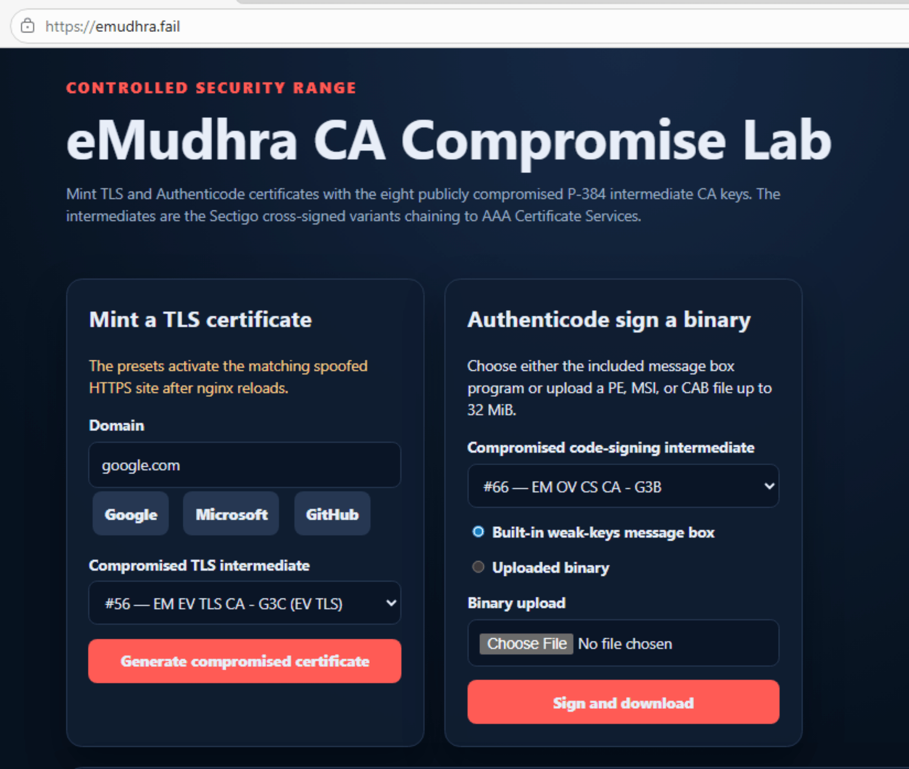
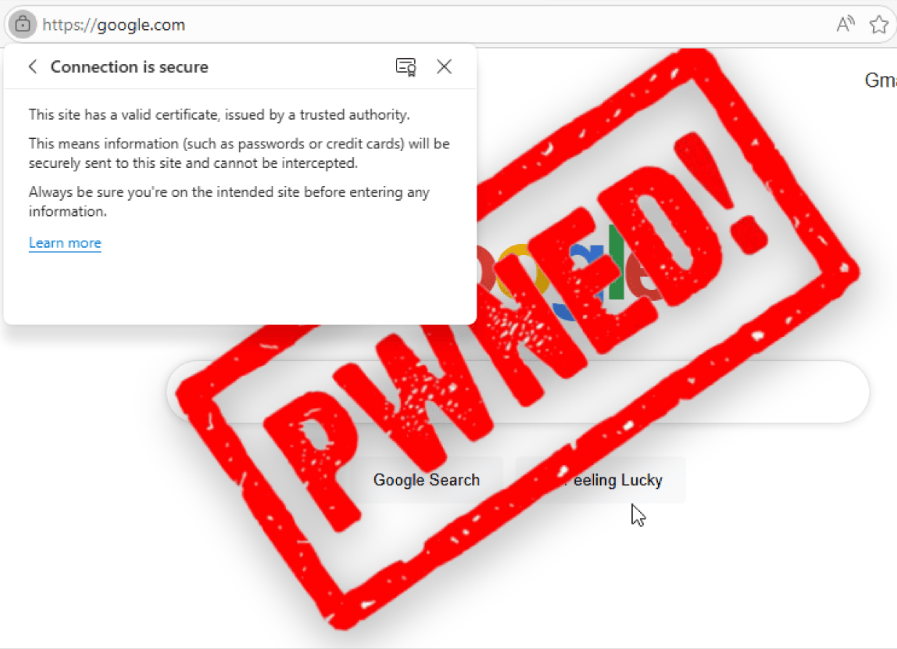
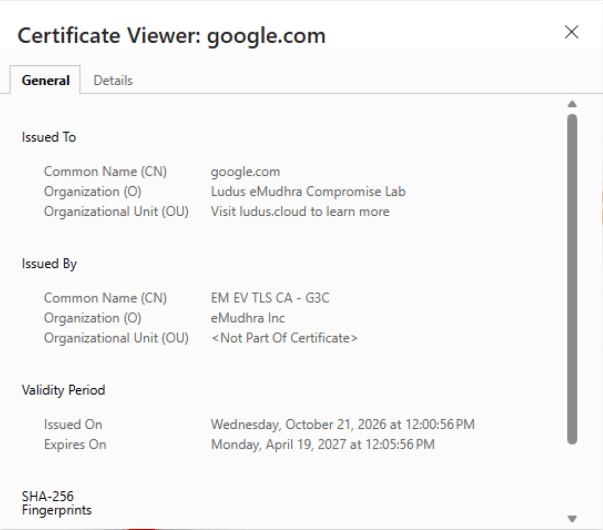
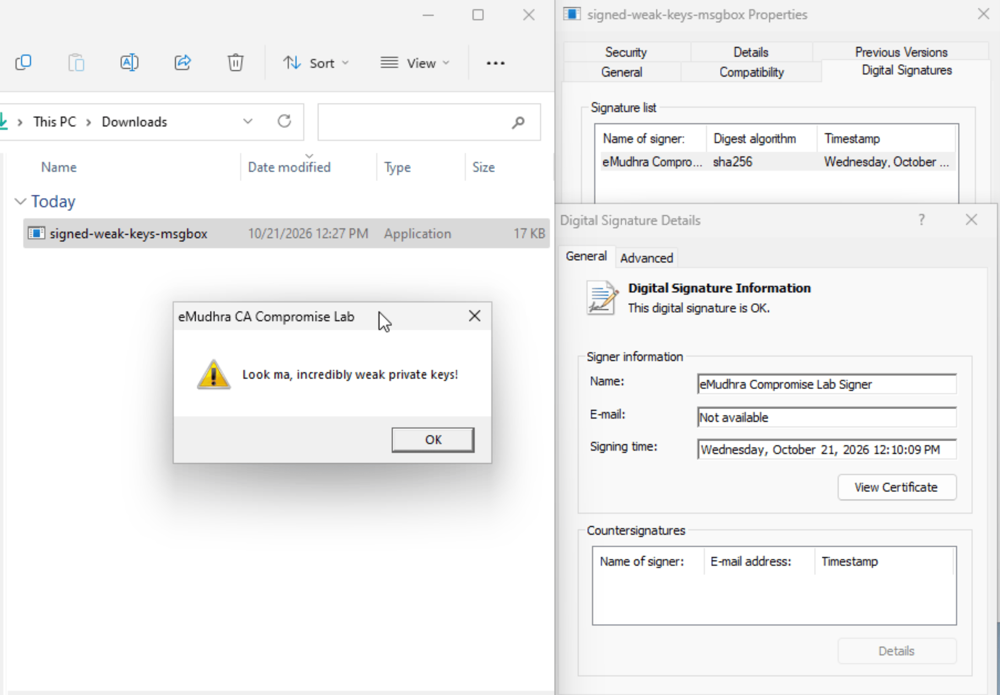

# Ansible Role: eMudhra Compromise Lab Server ([Ludus](https://ludus.cloud))

Deploys a controlled demonstration of the publicly compromised eMudhra intermediate certificate authorities to a Debian host. The role installs an eMudhra lab service behind nginx and provides:

- An HTTPS dashboard at `https://emudhra.fail/`.
- TLS certificate generation with six compromised eMudhra TLS intermediates.
- Spoof training pages for `google.com`, `microsoft.com`, and `github.com`.
- Authenticode signing with two compromised eMudhra code-signing intermediates.
- A built-in Windows message-box sample and uploads for PE, DLL, MSI, or CAB files up to 32 MiB.
- Downloads of generated leaf certificates, full chains, and private keys.

The role does not configure client DNS or trust stores. Lab clients must resolve `emudhra.fail` and any exercised spoof domain to the lab VM.

## Screenshots

The dashboard provides the TLS certificate generator and Authenticode signing form:



After generating a certificate for `google.com` and routing the domain to the lab VM, the browser accepts the compromised certificate and loads the spoofed page:



The certificate viewer shows the generated `google.com` leaf certificate issued by the compromised `EM EV TLS CA - G3C` intermediate:



The built-in Windows sample can be signed with a compromised code-signing intermediate. Windows reports the resulting digital signature as valid:




## Use with Ludus

```
ludus ansible role add badsectorlabs.ludus_emudhra_lab_server
git clone https://github.com/badsectorlabs/ludus_emudhra_lab_server
ludus range create -r CAFAIL -n CAFAIL -d "eMudhra compromised intermediate CA demonstration"
ludus range config set -r CAFAIL -f ludus_emudhra_lab_server/range-config.yml
ludus range deploy -r CAFAIL
```

## Role Variables

Available variables and their defaults are defined in `defaults/main.yml`:

| Variable | Default | Description |
| --- | --- | --- |
| `emudhra_lab_user` | `emudhra-lab` | System account that runs the lab service. |
| `emudhra_lab_group` | `emudhra-lab` | Primary group for the service account. |
| `emudhra_lab_install_dir` | `/opt/emudhra-lab` | Immutable server binary, compromised CA material, and static assets. |
| `emudhra_lab_data_dir` | `/var/lib/emudhra-lab` | Mutable certificates, signing identities, uploaded artifacts, and lab state. |
| `emudhra_lab_listen` | `127.0.0.1:8080` | Internal HTTP address used by the lab service behind nginx. |

Changing the user, group, or directory variables is supported. Keep the service listener private unless the surrounding network controls provide equivalent isolation.

## Installed Services and Files

| Path or service | Purpose |
| --- | --- |
| `emudhra-lab.service` | Runs the dashboard, certificate generator, and signing service. |
| `nginx.service` | Terminates HTTP/HTTPS and serves the configured lab hostnames. |
| `/opt/emudhra-lab/emudhra-lab-server` | Lab server executable. |
| `/opt/emudhra-lab/ca/` | Compromised intermediate certificates and private keys. |
| `/opt/emudhra-lab/assets/` | Spoof-page image and built-in Windows sample. |
| `/var/lib/emudhra-lab/` | Generated certificates, signing material, artifacts, and state. |

Both services are enabled and started during deployment. The default nginx virtual host is disabled.

## Dependencies

No Ansible role dependencies.

## Example Playbook

This example assumes the role is installed with the identifier `emudhra_lab_server`:

```yaml
---
- name: Deploy the eMudhra compromise lab
  hosts: emudhra_lab_hosts
  become: true
  roles:
    - role: emudhra_lab_server
  vars:
    emudhra_lab_listen: 127.0.0.1:8080
```

Use the namespaced role identifier instead if your Ansible Galaxy or Ludus installation assigns one.

## Example Ludus Range Config

Confirm the Debian 13 template name with `ludus templates list`, install the role on the Ludus server, and then apply a configuration such as:

```yaml
# yaml-language-server: $schema=https://docs.ludus.cloud/schemas/range-config.json

ludus:
  - vm_name: "{{ range_id }}-victim"
    hostname: "{{ range_id }}-victim"
    template: win11-22h2-x64-enterprise-template
    vlan: 10
    ip_last_octet: 10
    ram_gb: 4
    cpus: 2
    windows:
      sysprep: false

  - vm_name: "{{ range_id }}-emudhra"
    hostname: "{{ range_id }}-emudhra"
    template: debian-13-x64-server-template
    vlan: 20
    ip_last_octet: 10
    ram_gb: 4
    cpus: 2
    linux: true
    dns_rewrites:
      - google.com
      - microsoft.com
      - github.com
      - emudhra.fail
    roles:
      - emudhra_lab_server

router:
  vm_name: '{{ range_id }}-router-debian13-x64'
  hostname: '{{ range_id }}-router-debian13-x64'
  template: debian-13-x64-server-template
  ram_gb: 2
  cpus: 2
  ram_min_gb: 0.5
  # We need these to make sure Windows doesn't update itself right after being cloned
  iptables_commands:
    - >-
      iptables -I LUDUS_DEFAULTS 1
      -s 10.{{ range_second_octet }}.10.0/24
      -d 198.51.100.0/24
      -m comment --comment "Allow victim VLAN replies to WireGuard clients"
      -j ACCEPT
    - >-
      iptables -I LUDUS_DEFAULTS 2
      -s 10.{{ range_second_octet }}.10.0/24
      -d 192.0.2.0/24
      -m comment --comment "Allow victim VLAN replies to Ludus control plane"
      -j ACCEPT
    - >-
      iptables -I LUDUS_DEFAULTS 3
      -s 10.{{ range_second_octet }}.10.0/24
      ! -d 10.{{ range_second_octet }}.0.0/16
      -m comment --comment "Block victim VLAN internet access"
      -j REJECT

network:
  inter_vlan_default: REJECT
  external_default: ACCEPT
  wireguard_vlan_default: ACCEPT
  rules:
    - name: Allow victim web access to spoof server
      vlan_src: 10
      ip_last_octet_src: 10
      vlan_dst: 20
      ip_last_octet_dst: 10
      protocol: tcp
      ports: 80,443
      action: ACCEPT
    - name: Allow victim diagnostics to spoof server
      vlan_src: 10
      ip_last_octet_src: 10
      vlan_dst: 20
      ip_last_octet_dst: 10
      protocol: icmp
      ports: all
      action: ACCEPT

```

Adjust the template and installed role identifiers to match the Ludus server.

## Client Setup and Lab Workflow

1. Create isolated DNS overrides for `emudhra.fail`, `google.com`, `microsoft.com`, and `github.com`, all pointing to the lab VM.
2. Open `https://emudhra.fail/`.
3. Generate a TLS certificate. Generating one of the three preset domains activates its spoof page and reloads nginx.
4. Visit the selected preset domain from the isolated client.
5. Use the signing form to sign the built-in sample or an uploaded `.exe`, `.dll`, `.msi`, or `.cab` file.

The dashboard can mint certificates for other valid DNS names and provides their certificate, chain, and private-key downloads. Only the three preset domains have built-in spoof pages.


To test the service without changing DNS, set `LAB_VM_IP` to the VM address and use curl's one-request resolver override:

```bash
curl --insecure \
  --resolve "emudhra.fail:443:${LAB_VM_IP}" \
  https://emudhra.fail/healthz
```

A healthy deployment returns `ok`.

## Operations

```bash
systemctl status emudhra-lab nginx
journalctl --unit emudhra-lab --follow
nginx -t
```

Generated state persists under `emudhra_lab_data_dir`. Removing and redeploying the role does not automatically erase that directory.

## License

MIT

## Author Information

This role was created by [Bad Sector Labs](https://badsectorlabs.com/), for [Ludus](https://ludus.cloud/).
